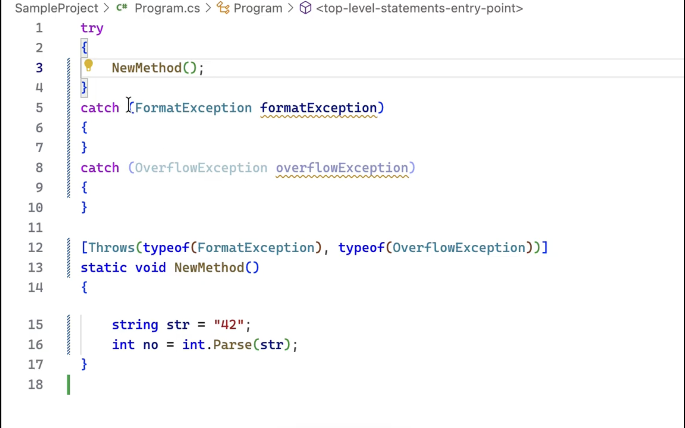

# Checked Exceptions for C#

**Take control of exception flow — enforce explicit handling or declaration in C#**

[](…)   [](https://www.nuget.org/packages/Sundstrom.CheckedExceptions/) 

[❓ FAQ](#user-content--frequently-asked-questions-faq) • [🧪 Sample project](https://github.com/marinasundstrom/CheckedExceptions/blob/main/SampleProject/Program.cs) • [📚 Documentation](docs) • [📝 Change Log](CHANGELOG.md)

---

## Demo

_Click the image to watch the [video](https://www.youtube.com/watch?v=ldJjMrqB8X4) om YouTube._

<a href="https://www.youtube.com/watch?v=ldJjMrqB8X4"></a>

There are other videos in [this playlist](https://www.youtube.com/playlist?list=PLLBU--06ftFpmZWhQExVDXcefWol1i0zq).

---

## 🚀 What It Does

CheckedExceptions is a Roslyn analyzer that makes exception handling **explicit** and reveals how exceptions propagate through your code.

If a method might throw an exception, the caller must either:

* 🧯 Handle it (with `try/catch`), or
* 📣 Declare it (with `[Throws(typeof(...))]`)

✅ Inspired by Java’s checked exceptions<br />
⚙️ Fully opt-in<br />
💡 Analyzer warnings by default — can be elevated to errors<br />
📄 Supports .NET and third-party libraries via XML documentation<br />
🛠 Includes code fixes to help you quickly handle or declare exceptions<br />
➕ Supports .NET Standard 2.1<br />

---

## ✅ Quick Example

```csharp
public class Sample
{
    public void Execute()
    {
        // ⚠️ THROW001: Unhandled exception type 'InvalidOperationException'
        Perform();
    }

    [Throws(typeof(InvalidOperationException))]
    public void Perform()
    {
        throw new InvalidOperationException("Oops!");
    }
}
```

✔️ Fix it by **handling**:

```csharp
public void Execute()
{
    try { Perform(); }
    catch (InvalidOperationException) { /* handle */ }
}
```

Or by **declaring**:

```csharp
[Throws(typeof(InvalidOperationException))]
public void Execute()
{
    Perform();
}
```

---

## 🧠 Why Use It?

- Avoid silent exception propagation
- Document intent with `[Throws]` instead of comments
- Enforce better error design across your codebase
- Works with unannotated .NET methods via XML docs
- Plays nice with nullable annotations
- Avoid confusing [Throws] with `<exception>` — enforce contracts, not just documentation

---

## 📦 Installation

```bash
dotnet add package Sundstrom.CheckedExceptions
```

And define `ThrowsAttribute` in your project:

```csharp
[AttributeUsage(AttributeTargets.Method | AttributeTargets.Constructor | AttributeTargets.Delegate | AttributeTargets.Property, AllowMultiple = true)]
public class ThrowsAttribute : Attribute
{
    public List<Type> ExceptionTypes { get; } = new();
    public ThrowsAttribute(Type exceptionType, params Type[] others) { … }
}
```

Find the full definition [here](https://github.com/marinasundstrom/CheckedExceptions/blob/main/CheckedExceptions.Attribute/ThrowsAttribute.cs).

---

## ⚙️ Configuration

### .editorconfig

```ini
dotnet_diagnostic.THROW001.severity = warning
dotnet_diagnostic.THROW003.severity = warning
```

### `.csproj`

```xml
<PropertyGroup>
  <WarningsAsErrors>nullable,THROW001</WarningsAsErrors>
</PropertyGroup>
```

---

### JSON Settings

A baseline template is available in `default-settings.json`. For guidance on choosing the right defaults for your project, see the [configuration guide](docs/configuration-guide.md).

The analyzer uses a single `exceptions` dictionary that classifies each exception type as `Ignored`, `Informational`, `NonStrict`, or `Strict`.

**By default, exceptions are treated as `Strict`.**
This means that any exception not explicitly classified must be **caught or declared** using `[Throws]`.

You can relax this behavior by classifying specific exception types as `NonStrict`, which lowers the severity and allows them to propagate without requiring a declaration. `NonStrict` exceptions are still fully analyzed — you may catch or declare them explicitly, and doing so is not considered redundant.

Only exceptions classified as `Ignored` are completely excluded from analysis.

Add `CheckedExceptions.settings.json`:

```json
{
  // Default classification for exceptions not listed (default: Strict)
  "defaultExceptionClassification": "Strict",
  "exceptions": {
    "System.ArgumentNullException": "Ignored",
    "System.IO.IOException": "Informational",
    "System.TimeoutException": "NonStrict"
  },

  // If true, exceptions will not be read from XML documentation (default: false).
  "disableXmlDocInterop": false,

  // If true, analysis on LINQ constructs will be disabled (default: false).
  "disableLinqSupport": false,

  // If true, implicit exception inference in LINQ lambdas is disabled and declarations are required (default: false).
  "disableLinqImplicitlyDeclaredExceptions": false,

  // If true, no diagnostics will be issued on contract boundaries, such as arguments to methods and return statements (default: false).
  "disableLinqEnumerableBoundaryWarnings": false,

  // If true, control flow analysis, with redundancy checks, is disabled (default: false).
  "disableControlFlowAnalysis": false,

  // If true, basic redundancy checks are available when control flow analysis is disabled (default: false).
  "enableLegacyRedundancyChecks": false,

  // If true, declaring [Throws(typeof(Exception))] acts as a catch-all and suppresses hierarchy redundancy checks;
  // the base-type warning (THROW003) remains unless "disableBaseExceptionDeclaredDiagnostic" is set (default: false).
  "treatThrowsExceptionAsCatchRest": false,

  // If true, the analyzer will not warn about declaring base type Exception with [Throws] (default: false).
  "disableBaseExceptionDeclaredDiagnostic": false,

  // If true, the analyzer will not warn about throwing base type Exception (default: false).
  // Set to true if you use another analyzer reporting a similar diagnostic.
  "disableBaseExceptionThrownDiagnostic": false
}
```

---

## 🔍 Diagnostics

| ID         | Message                                                                 |
|------------|-------------------------------------------------------------------------|
| `THROW001` | ❗ Unhandled exception: must be caught or declared                      |
| `THROW002` | ℹ️ Non-strict exception may cause runtime issues                       |
| `THROW003` | 🚫 Avoid declaring exception type `System.Exception`                    |
| `THROW004` | 🚫 Avoid throwing exception base type `System.Exception`                |
| `THROW005` | 🔁 Duplicate declarations of the same exception type in `[Throws]`      |
| `THROW006` | 🧬 Incompatible Throws declaration (not declared on base member)        |
| `THROW007` | 🧬 Missing Throws declaration for base member's exception               |
| `THROW008` | 📦 Exception already handled by declaration of super type in `[Throws]` |
| `THROW009` | 🧹 Redundant catch typed clause                                         |
| `THROW010` | ⚠️ `[Throws]` is not valid on full property declarations                |
| `THROW011` | 📄 Exception in XML docs is not declared with `[Throws]`                |
| `THROW012` | 🧹 Redundant exception declaration (declared but never thrown)          |
| `THROW013` | 🧹 Redundant catch-all clause (no remaining exceptions to catch)        |
| `THROW014` | 🧹 Catch clause has no remaining exceptions to handle                   |
| `THROW015` | 🧹 Catch clause is redundant (General diagnostic)                       |
| `THROW020` | 🛑 Unreachable code detected                                            |
| `IDE001`   | 🙈 Unreachable code (hidden diagnostic for editor greying)              |

## 🛠 Code Fixes

The analyzer offers the following automated code fixes:

* ✅ **Add exception declaration**
  Adds `[Throws(typeof(...))]` attribute to declare the exception, or appends exception to existing attribute.
  *(Fixes `THROW001`)*

* 🧯 **Surround with try/catch**
  Wraps the throwing site in a `try`/`catch` block.
  *(Fixes `THROW001`)*

* ➕ **Add catch to existing try block**
  Appends a new `catch` clause to an existing `try`.
  *(Fixes `THROW001`)*

* 🧹 **Remove redundant catch clause**
  Removes a catch clause for an exception type that is never thrown.
  *(Fixes `THROW009`, `THROW013`, `THROW014`)*

* 🔧 **Add `[Throws]` declaration from base member**
  Ensures overridden or implemented members declare the same exceptions as their base/interface.
  *(Fixes `THROW007`)*

* 🔧 **Add `[Throws]` declaration from XML doc**
  Converts `<exception>` XML documentation into `[Throws]` attributes.
  *(Fixes `THROW011`)*

* ➕ **Introduce catch clauses from rethrow in catch-all**
  Appends new `catch` clauses before "catch all".
  *(Fixes `THROW001`)*

---

## ✨ Advanced Features

* **Lambdas, local functions, accessors, events** – full support across member kinds
* **Exception inheritance analysis** – understands base/derived exception relationships
* **XML documentation interop** – merges `[Throws]` with `<exception>` tags from external libraries
* **Nullability awareness** – respects `#nullable enable` context
* **Standard library knowledge** – recognizes common framework exceptions (e.g. `Console.WriteLine` → `IOException`)
* **Control flow analysis** – detects whether exceptions are reachable, flags redundant `catch` clauses, and reports unreachable code caused by prior throws or returns

---

## ❓ Frequently Asked Questions (FAQ)

### ❓ How is this different from Java's checked exceptions?

**Answer:**

Java's checked exceptions are **mandatory** — the compiler enforces them, and every method must declare or handle them. While this promotes visibility, it also leads to friction, boilerplate, and workarounds like `throws Exception`.

This analyzer takes a **modern, flexible approach**:

* ⚠️ **Warnings by default**, not errors — you’re in control.
* ✍️ **Opt-in declaration** using `[Throws]` — only where it matters.
* 🛠️ **Code fixes and suppression** make adoption practical.
* 🔄 **Gradual adoption** — use it for new code, leave legacy code untouched.
* 🎯 **Focused on intention**, not obligation — you declare what callers need to know, not what `int.Parse` might throw.

> ✅ Summary:
> This is *exception design with intent*, not enforcement by force. It improves exception hygiene without the rigidity of Java’s model.

### ❓ Can I use `<exception>` XML documentation tags instead of the `[Throws]` attribute?

**Answer:**

No — for your own code, `<exception>` tags are **not treated as semantic declarations** by the analyzer. While they are useful for documentation and IntelliSense, they are not part of the C# language’s type system and cannot be reliably analyzed or enforced.

Instead, we encourage and require the use of the `[Throws]` attribute for declaring exceptions in a way that is:

- Explicit and machine-readable  
- Suitable for static analysis and enforcement  
- Integrated with code fixes and tooling support

#### 🧩 Interoperability with external libraries

When analyzing external APIs (e.g., referenced .NET assemblies), we **do** recognize `<exception>` tags from their XML documentation — but only for **interop purposes**. That is:

- We treat documented exceptions from public APIs as "declared" when `[Throws]` is not available.
- This helps maintain compatibility without requiring upstream changes.

> ⚠️ Summary:  
> `<exception>` tags are respected for **interop**, but they are **not a replacement** for `[Throws]` in code you control.

### ❓ What about .NET Standard 2.0 support?

**Answer:**

The analyzer offers **limited support** for projects targeting .NET Standard 2.0. You’ll still get accurate diagnostics for your own code, as well as third-party libraries. However, members defined in the .NET Standard framework may not indicate which exceptions they throw.

This is due to a **technical limitation**: the XML documentation files for .NET Standard assemblies are often incomplete or malformed, making it impossible to extract reliable exception information.

✅ **Recommendation:** Target a modern .NET SDK (e.g., .NET 6 or later) to get full analyzer support, including framework exception annotations.

### ❓ What about LINQ support?

**Answer:**

There is support for LINQ query operators on `IEnumerable<T>` and asynchronous operators like `FirstAsync` on `IAsyncEnumerable<T>` (via [System.Linq.Async](https://www.nuget.org/packages/System.Linq.Async)). Support for `IQueryable<T>` is enabled by default and can be disabled via the `disableLinqQueryableSupport` setting.

```csharp
List<string> values = [ "10", "20", "abc", "30" ];

var tens = values
    .Where(s => int.Parse(s) % 10 is 0)
    .ToArray(); // THROW001: unhandled FormatException, OverflowException
```

> Exceptions are inferred and implicit on LINQ methods. Any explicit `[Throws]` on LINQ lambdas is flagged as redundant. This behavior can be disabled.

Read about it [here](docs/linq-support.md).

---

## 🤝 Contributing

1. Fork  
2. Create feature branch  
3. Push PR with tests & documentation  
4. ❤️

---

## 📜 License

[MIT](LICENSE)
